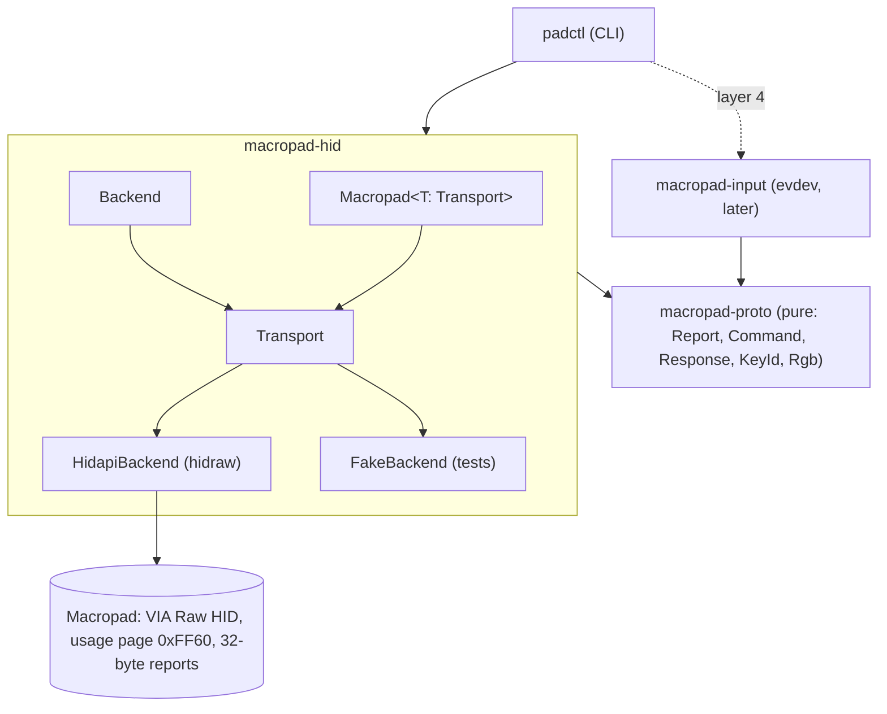

# fw16-macropad

Host-side control for the Framework Laptop 16 RGB Macropad (`32ac:0013`, RP2040, 24 RGB keys, QMK with VIA).

The goal is a macropad whose keys have no fixed meaning. Programs on the host light keys and react to presses at runtime: a notification turns two keys red, pressing one of them dismisses it.

## Status

Layer 2 (raw LED control). Global lighting works on stock firmware (`padctl light ...`). Per-key colour (`padctl key ...`) needs the padctl firmware in [`firmware/`](firmware/README.md). Nothing has been tested on hardware yet.

## Layer roadmap

Each layer is finished, tested and reviewed before the next starts.

1. **Skeleton.** Workspace, crate boundaries, domain types, transport trait, fake device, CI.
2. **Raw LED control.** What the stock firmware allows (global RGB matrix effect, HSV, brightness over VIA) versus what needs custom firmware (per-key colour over VIA custom channel 0). Single LED vs many in one report.
3. **Simple API.** A small typed surface over layer 2, for example "set these keys to this colour", independent of how the firmware does it.
4. **Dynamic use cases.** evdev input (grabbed by `32ac:0013`), a daemon that hands out keys to clients and routes presses back, notifications as the first client.

Layer 3 (in design): `padd` daemon owning LEDs and the grabbed input device, JSON-lines socket, `padctl claim`. See [ADR 0004](docs/adr/0004-layer-3-daemon-and-claims.md) and [docs/protocol.md](docs/protocol.md).

## Architecture



- `macropad-proto` owns every byte. No I/O. Command `0x0B` cannot be encoded (Framework uses it for factory and bootloader functions).
- `macropad-hid` finds the Raw HID interface and exchanges reports. `Backend` and `Transport` are traits, so the CLI is tested against an in-memory fake.
- `macropad-input` will read key presses by physical position.
- `padctl` is a thin shell: parse args, pick a backend, call `run`.

See [docs/adr/](docs/adr/): 0001 layering, 0002 RGB to HSV on the global path, 0003 the per-key channel-0 sub-protocol.

## Dev setup (mise)

```sh
# Omarchy / Arch (system packages: firmware cross-compiler + C library)
sudo pacman -S --needed mise arm-none-eabi-gcc arm-none-eabi-newlib make git
# Debian / Ubuntu equivalent: sudo apt install gcc-arm-none-eabi libnewlib-arm-none-eabi make git
mise trust && mise install      # rust stable (+rustfmt, clippy), cargo-deny, uv
mise tasks                      # list tasks
```

| Task | What it does |
|------|--------------|
| `mise run build` | Debug build of the workspace |
| `mise run build-release` | Optimised `target/release/padctl` (LTO, 1 codegen unit, stripped) |
| `mise run test` | All tests against the fake device |
| `mise run lint` | `cargo fmt --check` + clippy pedantic with `-D warnings` |
| `mise run deny` | `cargo deny check licenses bans sources` |
| `mise run ci` | `lint` + `test` + `deny` |
| `mise run install` | `cargo install --path crates/padctl --locked` |
| `mise run firmware` | Build `firmware/build/framework_macropad_padctl.uf2` (checks for arm-none-eabi-gcc/newlib first; uv makes a cached Python 3.12 venv for QMK's tooling under `~/.cache/fw16-macropad/venv`) |
| `mise run bootloader` | `padctl bootloader` (asks first) |
| `mise run flash` | firmware, bootloader, wait for `RPI-RP2`, copy, sync, wait for the pad, `padctl info` |

Shell completions and man page: `padctl completions zsh > ~/.local/share/zsh/site-functions/_padctl`, `padctl man > ~/.local/share/man/man1/padctl.1`. Release tarballs ship both.

## Use

```sh
sudo cp contrib/udev/70-fw16-macropad.rules /etc/udev/rules.d/
sudo udevadm control --reload && sudo udevadm trigger
padctl list
padctl info                 # via_protocol, per_key support
padctl light color '#ff8000' # all keys, stock firmware
padctl light show
padctl key set -c red 0 1    # needs padctl firmware
padctl key clear --all
padctl key mode overlay      # or exclusive (default)
```

Keys are numbered 0-23 row-major from the top left. Nothing is saved to EEPROM except by `padctl light save`.

## Flashing

Have an external keyboard or the touchpad handy: in bootloader mode the macropad is not a keyboard. Never put the main keyboard and the macropad in bootloader mode at the same time; both show up as `RPI-RP2` and cannot be told apart.

1. **Via padctl (normal path).** `mise run flash` does everything. By hand: `padctl bootloader`, wait for the `RPI-RP2` drive (Omarchy: `udisksctl mount -b /dev/disk/by-label/RPI-RP2` if it is not auto-mounted under `/run/media/$USER/`), copy the `.uf2` onto it, `sync`. The pad reboots by itself; `padctl info` should then show `per_key: v2 (24 keys)`.
2. **Key-hold fallback** (when padctl cannot reach the pad). Slide the touchpad down until the input deck powers off, hold keys **2 and 6** (numpad legend; padctl keys 17 and 14), slide the touchpad back up. Framework's release notes say keys 1 and 6 (padctl 16 and 14); the community confirms 2+6 for the macropad. Try 2+6 first, then 1+6.
3. **Num Lock fallback.** Hold **Num Lock** (row 2, column 1; padctl key 4) while inserting the module or re-powering the deck.
4. **Restore stock.** Download `framework_macropad_default_v0.3.1.uf2` from [FrameworkComputer/qmk_firmware v0.3.1](https://github.com/FrameworkComputer/qmk_firmware/releases/tag/v0.3.1) and flash it the same way (`scripts/flash.sh path/to/framework_macropad_default_v0.3.1.uf2`). `fwupdmgr update` also works for stock firmware.

## Releases

Pushing a `v*` tag runs `.github/workflows/release.yml`: tests, builds `padctl` for `x86_64-unknown-linux-gnu`, builds the `.uf2`, and attaches a tarball (binary, man page, bash/zsh/fish completions, udev rule) plus the `.uf2` and `SHA256SUMS` to a GitHub release.

## License

Rust crates: MIT OR Apache-2.0, at your option. `firmware/`: GPL-2.0-or-later.
