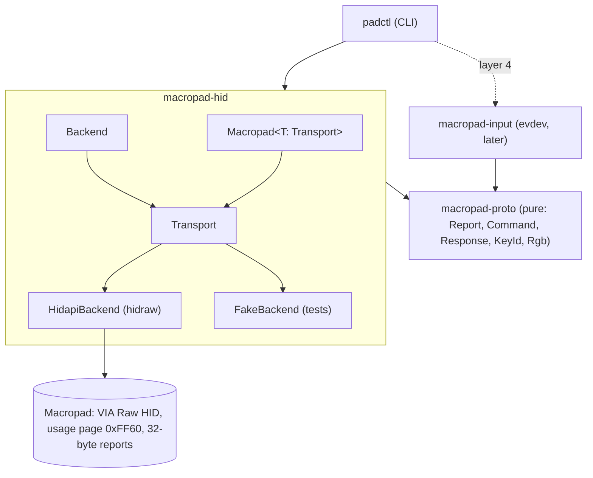

# fw16-macropad

Host-side control for the Framework Laptop 16 RGB Macropad (`32ac:0013`, RP2040, 24 RGB keys, QMK with VIA).

The goal is a macropad whose keys have no fixed meaning. Programs on the host light keys and react to presses at runtime: a notification turns two keys red, pressing one of them dismisses it.

## Status

Layer 1 (skeleton). `padctl list` and `padctl info` work over VIA Raw HID. Nothing else exists yet.

## Layer roadmap

Each layer is finished, tested and reviewed before the next starts.

1. **Skeleton.** Workspace, crate boundaries, domain types, transport trait, fake device, CI.
2. **Raw LED control.** What the stock firmware allows (global RGB matrix effect, HSV, brightness over VIA) versus what needs custom firmware (per-key colour over VIA custom channel 0). Single LED vs many in one report.
3. **Simple API.** A small typed surface over layer 2, for example "set these keys to this colour", independent of how the firmware does it.
4. **Dynamic use cases.** evdev input (grabbed by `32ac:0013`), a daemon that hands out keys to clients and routes presses back, notifications as the first client.

## Architecture



- `macropad-proto` owns every byte. No I/O. Command `0x0B` cannot be encoded (Framework uses it for factory and bootloader functions).
- `macropad-hid` finds the Raw HID interface and exchanges reports. `Backend` and `Transport` are traits, so the CLI is tested against an in-memory fake.
- `macropad-input` will read key presses by physical position.
- `padctl` is a thin shell: parse args, pick a backend, call `run`.

See [docs/adr/0001-layered-architecture.md](docs/adr/0001-layered-architecture.md).

## Use

```sh
sudo cp contrib/udev/70-fw16-macropad.rules /etc/udev/rules.d/
sudo udevadm control --reload && sudo udevadm trigger
cargo run -p padctl -- list
cargo run -p padctl -- info
```

## License

MIT OR Apache-2.0, at your option.
