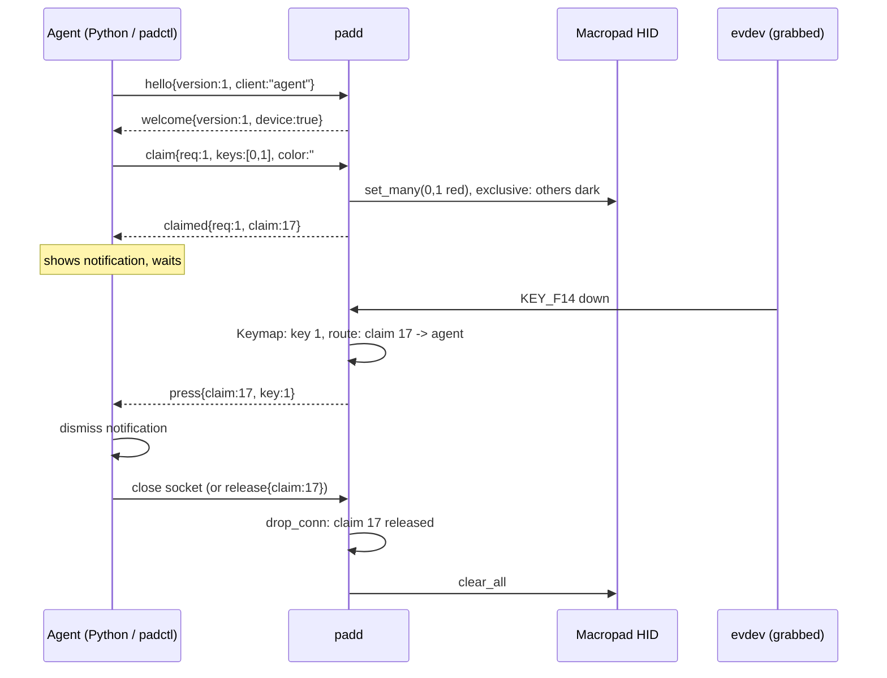

# 0004: Layer 3, a daemon that hands out keys

Status: proposed (2026-10-12), design only. Protocol: [docs/protocol.md](../protocol.md).

## Context

Layer 2 gives raw control: global lighting, per-key overrides with exclusive mode, and nothing for input. The goal is dynamic keys: a program lights some keys, the user presses one, that program (and only it) reacts. Several programs may want keys at once (a notification, a build watcher, an agent asking for approval). Robert never uses the pad as a numpad, so its key codes must not reach the desktop at all.

Two things cannot be shared safely: the Raw HID LED state (one writer, or frames fight) and the evdev grab (exclusive by definition). So one process must own both.

## Decision

### Crates

```
macropad-proto   pure HID bytes (layers 1-2)
macropad-hid     HID transport, Macropad, PerKeyLeds (layers 1-2)
macropad-input   evdev discovery + grab, Keymap, EventSource trait, fake
macropad-ipc     pure socket wire types (serde), like proto for the socket
macropad-client  blocking client over the socket
padd             daemon: lib (ClaimTable, Frame/LedSink, Daemon, seam) + bin
padctl           CLI; `padctl claim` uses macropad-client
```

Dependencies point one way: `padd` uses hid, input, ipc; `macropad-client` uses ipc only (no hidapi, no evdev); `padctl` uses hid and client.

**Separate `padd` binary, not `padctl daemon`.** The daemon is long-running, owns devices, and links evdev and the socket server; the CLI is one-shot and should stay small and usable for raw layer-2 work without the daemon. Separate binaries also give the systemd unit a stable `ExecStart` and a clear process name in `ps`/journal. Cost: two binaries to install; the release tarball and `mise run install` handle both.

### Input

- `find_devices()` matches `/dev/input/event*` with vendor `32ac`, product `0013`, and `EV_KEY`. All keyboard-like interfaces of the pad are grabbed (`EVIOCGRAB`), all-or-nothing, so no code leaks (including consumer/system-control interfaces).
- Key codes map to `KeyId` through `Keymap`, a checked bijection. **Framework's stock keymap cannot do this**: on the numpad layer three pairs share a code (`KP_0` ×2, `KP_PLUS` ×2, `KP_ENTER` ×2), and on the Num-Lock-off layer the RGB/backlight keys are handled inside the firmware and never reach evdev; which layer is active also follows the host's Num Lock LED. Proposal: padctl firmware v3 replaces the layers with one host layer of 24 distinct codes (`F13`-`F24` plus 12 more unused codes), `Keymap::padctl_v3()` mirrors it. See open question 1.
- Key-down produces `press`; key-up and autorepeat are dropped in v1 (types carry `Released` for later).

### Ownership and LEDs

- `padd` holds the HID transport and the grab for its whole life. While it runs, `padctl light`/`key` would fight it; they should detect the socket and refuse unless `--force` (open question 6).
- State is a `ClaimTable` (pure): claims, owner per key. Every change produces a full `Frame` (`[Option<Rgb>; 24]`) that `LedSink::show` paints (idempotent; diffing is an implementation detail). The real sink uses `PerKeyLeds::set_many` / `clear_all`; exclusive mode keeps unclaimed keys dark.
- At startup padd sets the global effect off and clears overrides, so "no claims" means a dark pad (open question 5).

### Claims

- `claim{keys,color,mode}` returns a `ClaimId`. **Newest claim wins** per key: the older claim loses those keys, its owner gets `preempted{lost,remaining,by}`. No stacking: lost keys do not return when the newer claim ends (simple, predictable; open question 4).
- Presses go only to the owner of the key's claim. Unclaimed presses go to the `UnclaimedPress` seam, which in layer 3 is `Ignore`. Layer 4 default actions plug in there; padd never stores client actions.
- `release{claim}` by the owner, or implicitly when the connection closes. A crashed client therefore never leaves keys lit.

### Socket

- `$XDG_RUNTIME_DIR/padd.sock`, `0600`, JSON lines, versioned by `hello`/`welcome` (major `1`). Per-connection claim limit and 4 KiB line limit protect the daemon.
- Startup: if a daemon answers on the socket, exit (`AlreadyRunning`); if the file is stale, replace it. On SIGTERM: clear overrides, release the grab, unlink the socket.

### Concurrency

std only, no async runtime: one input thread doing blocking evdev reads, one main thread `poll`ing listener and client sockets, joined by a channel (open question 3). Load is tiny (one human, 24 keys).

### Service

`contrib/systemd/padd.service`, a user unit bound to `graphical-session.target`, `Restart=on-failure`. udev grants the seat user the evdev nodes with `uaccess`, like the hidraw rule:

```
KERNEL=="event*", SUBSYSTEM=="input", ATTRS{idVendor}=="32ac", ATTRS{idProduct}=="0013", TAG+="uaccess"
```

(Not yet in `contrib/udev`; added with the implementation.)

### Agent notify flow



## Failure modes

| Situation | Behaviour |
|-----------|-----------|
| Client crashes / closes | All its claims released, LEDs repainted |
| Two clients want the same key | Newest wins, older gets `preempted` |
| Macropad disappears (deck off, bootloader) | Input thread reports `Disconnected`; clients get `device{present:false}`; padd retries discovery with backoff; claims kept and repainted on return |
| padd restarts / crashes | All sockets close, so clients see EOF and must reconnect and re-claim (no persisted claims). The firmware keeps the last overrides until padd starts again and clears them (open question 7) |
| Grab fails (another grabber) | padd exits with `Busy`; systemd retries |
| Stock or v2 firmware | padd refuses to start: needs `per_key` and the v3 keymap; error says to flash |
| Malformed client line | `error bad_request`; connection kept unless the line is oversized |

## Rejected

- Clients talk to the device directly: LED races, and the grab cannot be shared.
- D-Bus: heavier, and JSON lines over a socket is trivial from any language, including shell via `socat`.
- Storing actions in padd (key → command): keeps policy in the daemon and needs config and sandboxing; layer 4 may add defaults behind the seam.
- Stock keymap mapping: ambiguous codes, see Input.

## Open questions

1. **Firmware v3 host layer.** Change the padctl keymap to a single layer with 24 distinct codes, giving up on-pad RGB/Num Lock keys? Which codes (F13-F24 plus `INTL`/`LANG` codes are typical "unused" ones)? Recommended yes; it is the only way to get unambiguous keys.
2. **evdev crate.** `evdev` 0.13 (Apache-2.0 OR MIT, passes cargo-deny) vs. raw `ioctl` via `rustix`. Recommendation: `evdev`.
3. **sync vs tokio.** Recommendation: std threads + `poll` (via `rustix`), no tokio. Revisit if layer 4 grows timers/animations.
4. **Stacking.** Should lost keys return to the older claim when the newer one is released (a stack per key)? v1 says no.
5. **LED state with no claims.** Dark (proposed), or restore a configured global effect so the pad looks alive?
6. **padctl vs padd.** Should `padctl light`/`key` refuse while padd runs (proposed, with `--force`), or route through padd as a privileged client?
7. **padd restart.** Clients must re-claim; should `macropad-client` auto-reconnect and re-claim, or surface the error (proposed: surface; `padctl claim` exits 4)?
8. **Key-up events.** Needed for hold gestures? v1 sends only presses.
9. **Blink/pulse modes.** Host-side timing in padd (simple, costs reports) or a firmware animation per key (v3 protocol)?
