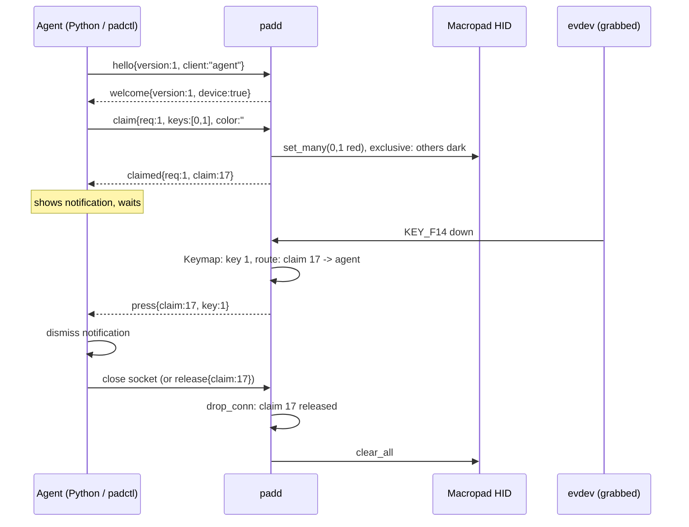

# 0004: Layer 3, a daemon that hands out keys

Status: accepted (2026-10-12) and implemented. Robert approved every recommendation below plus two additions. Protocol: [docs/protocol.md](../protocol.md).

## Context

Layer 2 gives raw control: global lighting, per-key overrides with exclusive mode, and nothing for input. The goal is dynamic keys: a program lights some keys, the user presses one, that program (and only it) reacts. Several programs may want keys at once (a notification, a build watcher, an agent asking for approval). Robert never uses the pad as a numpad, so its key codes must not reach the desktop at all.

Two things cannot be shared safely: the Raw HID LED state (one writer, or frames fight) and the evdev grab (exclusive by definition). So one process must own both.

## Decision

### Crates

```
macropad-proto   pure HID bytes (layers 1-2)
macropad-hid     HID transport, Macropad, PerKeyLeds (layers 1-2)
macropad-input   evdev discovery + grab, Keymap, EventSource trait, fake
macropad-ipc     pure socket wire types (serde), like proto for the socket
macropad-client  blocking client over the socket
padd             daemon: lib (ClaimTable, Frame/LedSink, Daemon, seam) + bin
padctl           CLI; `padctl claim` uses macropad-client
```

Dependencies point one way: `padd` uses hid, input, ipc; `macropad-client` uses ipc only (no hidapi, no evdev); `padctl` uses hid and client.

**Separate `padd` binary, not `padctl daemon`.** The daemon is long-running, owns devices, and links evdev and the socket server; the CLI is one-shot and should stay small and usable for raw layer-2 work without the daemon. Separate binaries also give the systemd unit a stable `ExecStart` and a clear process name in `ps`/journal. Cost: two binaries to install; the release tarball and `mise run install` handle both.

### Input

- `find_devices()` matches `/dev/input/event*` with vendor `32ac`, product `0013`, and `EV_KEY`. All keyboard-like interfaces of the pad are grabbed (`EVIOCGRAB`), all-or-nothing, so no code leaks (including consumer/system-control interfaces).
- Key codes map to `KeyId` through `Keymap`, a checked bijection. **Framework's stock keymap cannot do this**: on the numpad layer three pairs share a code (`KP_0` ×2, `KP_PLUS` ×2, `KP_ENTER` ×2), and on the Num-Lock-off layer the RGB/backlight keys are handled inside the firmware and never reach evdev; which layer is active also follows the host's Num Lock LED. padctl firmware v3 therefore replaces the layers with one host layer of 24 distinct codes. `Keymap::padctl_v3()` mirrors it:

| keys | QMK keycode | Linux code |
|------|-------------|------------|
| 0-11 | `KC_F13`-`KC_F24` | `KEY_F13`-`KEY_F24` (183-194) |
| 12-23 | `EXECUTE HELP MENU SELECT STOP AGAIN UNDO CUT COPY PASTE FIND INTERNATIONAL_1` | `OPEN HELP PROPS FRONT STOP AGAIN UNDO CUT COPY PASTE FIND RO` (134 138 130 132 128 129 131 137 133 135 136 89) |

The on-pad RGB and Num Lock keys are gone in v3. Lighting belongs to the host.

VIA keeps the keymap in EEPROM and only resets it when the EEPROM magic changes. That magic is derived from the build date, so a same-day reflash from v2 would have kept the old layers. The v3 keymap stamps `0x70640000 | version` into the user EEPROM word in `via_init_kb` and resets the dynamic keymap when the stamp differs. This happens once on the first boot of a new version. No command writes EEPROM.
- Key-down produces `press`; key-up and autorepeat are dropped in v1 (types carry `Released` for later).

### Ownership and LEDs

- `padd` holds the HID transport and the grab for its whole life. While it runs, `padctl light`/`key` would fight it; they detect a live padd on the socket and refuse unless `--force`.
- State is a `ClaimTable` (pure): claims, owner per key. Every change produces a full `Frame` (`[Option<Rgb>; 24]`) that `LedSink::show` paints (idempotent; diffing is an implementation detail). The real sink uses `PerKeyLeds::set_many` / `clear_all`; exclusive mode keeps unclaimed keys dark.
- At startup padd sets the global effect off and clears overrides, so "no claims" means a dark pad. When padd exits (SIGTERM), it clears the overrides.

### Claims

- `claim{keys,color,mode}` returns a `ClaimId`. **Newest claim wins** per key: the older claim loses those keys, its owner gets `preempted{lost,remaining,by}`. No stacking: lost keys do not return when the newer claim ends. This keeps it simple and predictable.
- Presses go only to the owner of the key's claim. Unclaimed presses go to the `UnclaimedPress` seam, which in layer 3 is `Ignore`. Layer 4 default actions plug in there; padd never stores client actions.
- **Timeout** (addition a): `timeout_ms` on `claim`. padd keeps the deadlines, wakes for the earliest one, drops the claim and sends `expired`. `padctl claim --timeout` sets it and also enforces it on the client, so the CLI exits 2 even if no event arrives.
- **Pause** (addition b): `pause`/`resume`/`status` ops; `padctl pause|resume|status`. Paused padd keeps claims and timers, shows a dark pad and swallows presses (the grab stays, so nothing leaks to the desktop). Starting and stopping the daemon stays with `systemctl --user`.
- `release{claim}` by the owner, or implicitly when the connection closes. A crashed client therefore never leaves keys lit.

### Socket

- `$XDG_RUNTIME_DIR/padd.sock`, `0600`, JSON lines, versioned by `hello`/`welcome` (major `1`). Per-connection claim limit and 4 KiB line limit protect the daemon.
- Startup: if a daemon answers on the socket, exit (`AlreadyRunning`); if the file is stale, replace it. On SIGTERM: clear overrides, release the grab, unlink the socket.

### Concurrency

std only, no async runtime and no tokio, as approved. The implementation does not use `poll(2)`, though. It runs one blocking thread per source, and each feeds one `mpsc` channel that the main thread owns:

- accept thread: new connections;
- one reader thread per connection: decoded lines and EOF;
- input: one reader thread per grabbed evdev node; on disconnect, rediscovery with a 2 s backoff;
- main: owns `ClaimTable`, the LEDs and every write; waits with `recv_timeout` until the next claim deadline or device retry.

Only the main thread changes state, so there are no locks around it. It also needs no `rustix`/`unsafe`, and the fake-input e2e tests can drive the same loop. The cost is one thread per client, which is fine for a handful of local clients. SIGTERM/SIGINT come in through `signal-hook` and shut down the same loop.

### Service

`contrib/systemd/padd.service`, a user unit bound to `graphical-session.target`, `Restart=on-failure`. udev grants the seat user the evdev nodes with `uaccess`, like the hidraw rule:

```
KERNEL=="event*", SUBSYSTEM=="input", ATTRS{idVendor}=="32ac", ATTRS{idProduct}=="0013", TAG+="uaccess"
```

This line is in `contrib/udev/70-fw16-macropad.rules`.

### Agent notify flow



## Failure modes

| Situation | Behaviour |
|-----------|-----------|
| Client crashes / closes | All its claims released, LEDs repainted |
| Two clients want the same key | Newest wins, older gets `preempted` |
| Macropad disappears (deck off, bootloader) | Input thread reports `Disconnected`; clients get `device{present:false}`; padd retries discovery with backoff; claims kept and repainted on return |
| padd restarts / crashes | All sockets close, so clients see EOF and must reconnect and re-claim (no persisted claims). There is no auto-reclaim: `macropad-client` surfaces the error and `padctl claim` exits 4. The firmware keeps the last overrides until padd starts again and clears them |
| Grab fails (another grabber) | Treated like an absent pad; logged and retried with backoff |
| Stock firmware (no `per_key`) | padd keeps running; `status` shows `device_error`, presses still route, LEDs retried with backoff |
| v2 firmware | Codes are not in the v3 keymap and get ignored; flash v3 |
| Malformed client line | `error bad_request`; connection kept unless the line is oversized |

## Rejected

- Clients talk to the device directly: LED races, and the grab cannot be shared.
- D-Bus: heavier, and JSON lines over a socket is trivial from any language, including shell via `socat`.
- Storing actions in padd (key → command): keeps policy in the daemon and needs config and sandboxing; layer 4 may add defaults behind the seam.
- Stock keymap mapping: ambiguous codes, see Input.

## Decisions (formerly open questions)

1. Firmware v3 has one host layer with 24 distinct codes (table above). The on-pad RGB and Num Lock keys are dropped.
2. The `evdev` 0.13 crate (Apache-2.0 OR MIT).
3. std threads, no tokio. The loop is channel-based instead of `poll` (see Concurrency).
4. No stacking.
5. Dark when there are no claims.
6. `padctl light`/`key` refuse while padd runs, unless `--force`.
7. No auto-reclaim after a padd restart. The client gets an error and `padctl claim` exits 4.
8. Presses only (`Released` stays in the types).
9. Blink and pulse come later, timed in padd on the host.

Additions: (a) `timeout_ms` with `expired`; (b) `pause`/`resume`/`status`.
